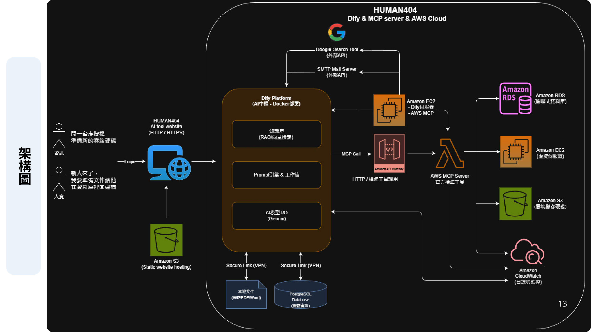

# HUMAN404 — 下班到點，拒絕加班

> **第二組｜HUMAN404**
> 一個整合「對外搜尋 × 對內知識庫 × 對雲端操作」的企業 AI 助手，
> 讓同事把重複性雜事交給 AI，君子動口不動手。

---

## 目錄

- [一、專案背景](#一專案背景)
- [二、HUMAN404 能做什麼](#二human404-能做什麼)
- [三、示範情境](#三示範情境)
- [四、系統架構](#四系統架構)
- [五、專案結構](#五專案結構)
- [六、快速啟動](#六快速啟動)
- [七、API 一覽](#七api-一覽)
- [八、環境變數](#八環境變數)
- [九、已知問題與注意事項](#九已知問題與注意事項)
- [十、團隊成員](#十團隊成員)
- [十一、參考資料](#十一參考資料)

---

## 一、專案背景

**WHAT — 下班時間到了，你卻走不了。**

- 業務查不到客戶資料，跑來找你求救
- 行銷找不到三年前的檔案，一直問你
- 老闆急著要報表，但大家還在手動 key 資料

**WHY — 這些重複的雜事瓜分了我們的時間**，讓人陷入加班惡夢，最後還被嫌棄工作效率差。

**HOW — 用一個 AI 助手把「找資料、查檔案、開機器」這三件事自動化。**
使用者只要用自然語言下指令，剩下的交給 HUMAN404。

---

## 二、HUMAN404 能做什麼

| 面向 | 能力 | 實作方式 |
| :--- | :--- | :--- |
| **對外** | Google 的眼睛 — 幫你找最新的外部資料 | Dify 內建 Serper（Google Search）工具 + Gemini 摘要 |
| **對內** | 企業知識庫的大腦 — 幫你找舊檔、查公司規章 | Dify Knowledge Retrieval（RAG / pgvector 向量檢索） |
| **對雲端** | AWS 的手腳 — 幫你控管雲端資源 | 自建 FastAPI 工具伺服器，以 OpenAPI schema 掛進 Dify 調用 EC2 / S3 / RDS |

整套流程由 **Dify Workflow** 當中樞：
先用 `question-classifier` 判斷使用者意圖屬於「往外部尋找資料 / 在內部尋找資料 / 使用 AWS 服務」，
再用 `parameter-extractor` 抽出需要的參數（例如要改哪一筆、改成什麼），最後才呼叫對應工具。

---

## 三、示範情境

以「IT 小白入職第一天」為主軸的三個情境：

### 情境 1｜開一台雲端主機（對雲端）

> 「幫我創立一台新的 EC2，規格 t2.micro，名字 HUMAN404-IT-1，套用 IAM 到 NEW 群組」

Dify 解析指令後調用工具進入 AWS 後台開機器，不必登入 Console 點來點去。

### 情境 2｜查公司內部規章（對內）

> 「公司特休規則」

先在企業知識庫做向量檢索，再由 LLM 摘要成人看得懂的回答。

### 情境 3｜查外部即時資訊（對外）

> 「2330 股價」

透過 Dify 的 Google Search 工具抓外部資料，再由 LLM 整理後輸出。

---

## 四、系統架構



資料流由左到右：

1. **使用者**（資訊人員 / 人資）登入 HUMAN404 AI tool website。
2. **Dify Platform**（Docker 部署的 AI 中樞）負責三件事：
   - 知識庫（RAG / 向量檢索）
   - Prompt 引擎 & 工作流
   - AI 模型 I/O（Gemini）
3. Dify 往下透過 Secure Link (VPN) 存取**本地文件（機密 PDF / Word）**與 **PostgreSQL 資料庫（機密資料）**，機密內容不外流。
4. Dify 往上呼叫**外部 API**：Google Search Tool、SMTP Mail Server。
5. Dify 往右以 **MCP Call** 經 API Gateway 進到 **AWS MCP Server**，再操作 **EC2 / S3 / RDS / CloudWatch**。

> ⚠️ 架構圖是簡報上的完整規劃藍圖。本 repo 目前實際落地的部分是：Dify 自架環境、FastAPI 工具伺服器（EC2 / S3 / RDS-MySQL）、Dify Workflow DSL、公司資料查詢 API 與測試資料集。SMTP Mail Server、API Gateway、CloudWatch、S3 靜態網站託管尚未包含在程式碼中。

---

## 五、專案結構

```
HUMAN404-Project/
├── backend/                     # AWS 工具伺服器（FastAPI）
│   ├── server.py                # 18 支 API：Database / S3 / EC2
│   ├── seed_data.py             # 在 RDS(MySQL) 建立 document_store 並塞測試資料
│   ├── schema.json              # server.py 匯出的 OpenAPI schema（給 Dify 匯入用）
│   ├── 各功能說明.md             # 每支 API 的行為說明
│   ├── Dockerfile
│   └── requirements.txt
├── Dify-workflow/               # Dify 工作流與工具設定
│   ├── AWS Project.yml          # Workflow DSL，可直接 Import 進 Dify
│   ├── mcp-tools.json           # Dify Custom Tool 用的 OpenAPI schema
│   ├── README.md                # 部署與匯入步驟
│   └── Pictures/                # 匯入流程截圖
├── docker/                      # 本地自架 Dify
│   ├── docker-compose.yaml      # api / worker / web / db / redis / nginx / plugin_daemon / ssrf_proxy
│   └── nginx/conf.d/default.conf
├── company_api/                 # 上市公司查詢 API（Flask，供 Dify 當外部工具）
│   ├── app.py                   # GET /companies
│   ├── docker-compose.yaml
│   ├── openapi.json
│   └── Dockerfile
├── docs/                        # 專案文件
│   └── architecture.png
├── tools/                       # 外部工具設定與說明
├── companies.csv                # 全球市值前 100 大公司資料
├── seed_companies.py            # 產生 public_companies 的 INSERT 語法
├── insert_companies.sql         # 上述產出的結果
├── generate_mock_data.py        # 產生 mock_companies 假資料
├── insert_data.sql              # 上述產出的結果（100 筆）
└── backup_mock_companies.sql    # mock_companies 的 pg_dump 備份
```

---

## 六、快速啟動

### 前置需求

- Docker / Docker Compose
- Python 3.10+
- 一組 AWS 憑證（建議建立專用 IAM User，最小權限）
- Gemini API Key（Dify 內的 LLM）

### 步驟 1｜啟動本地 Dify

```bash
cd docker
# 先建立 .env，至少要有：
#   POSTGRES_DB / POSTGRES_USER / POSTGRES_PASSWORD
#   SECRET_KEY
#   CONSOLE_API_URL / CONSOLE_WEB_URL / SERVICE_API_URL / APP_API_URL
#   STORAGE_TYPE / STORAGE_LOCAL_ROOT
docker compose up -d
```

啟動後以瀏覽器開啟 `http://YOUR-PC-IP`（Nginx 走 80 port），完成管理員帳密設定即可登入。
資料庫使用 `pgvector/pgvector:pg16`，知識庫的向量檢索就是靠它。

### 步驟 2｜啟動 AWS 工具伺服器

```bash
cd backend
pip install -r requirements.txt
# 建立 .env：DB_HOST / DB_USER / DB_PASSWORD / DB_NAME（指向你的 RDS MySQL）
python seed_data.py    # 首次執行：建立 document_store 資料表
python server.py       # 監聽 0.0.0.0:8001
```

AWS 憑證讀取順序：優先使用名為 `ai-mcp-user` 的 AWS profile，找不到就退回環境變數；region 固定為 `ap-northeast-1`。

啟動後可到 `http://<你的位址>:8001/docs` 看 Swagger UI。

### 步驟 3｜把工具掛進 Dify

1. 進入 Dify **Studio → Import DSL File**，選擇 `Dify-workflow/AWS Project.yml`。
2. 到 **Tools → Custom → Create Custom Tool**，把 `backend/schema.json`（或 `Dify-workflow/mcp-tools.json`）的內容貼到 Schema 區塊後建立。
   - **務必先把 schema 裡的 `servers.url` 改成你自己的伺服器位址**，repo 內留的是當時測試環境的位址。
3. 回到 Workflow，重新指定各個工具節點對應到你剛建立的工具（原檔的 provider 名稱是 `Jason-aws-mcp` 與 `Jason-aws-rdsDB`）。
4. LLM 節點（`gemini-2.5-flash`）與 Serper 搜尋工具的 API Key 需要另外設定。

詳細圖文步驟見 [`Dify-workflow/README.md`](Dify-workflow/README.md)。

### 步驟 4｜（選用）啟動公司資料查詢 API

```bash
cd company_api
docker compose up -d    # 監聽 5005，並掛上 Dify 的 docker_default 外部網路
```

先把測試資料灌進 Dify 的 PostgreSQL：

```bash
psql -h <host> -U postgres -d dify -f insert_companies.sql   # public_companies（真實市值前 100 大）
psql -h <host> -U postgres -d dify -f insert_data.sql        # mock_companies（100 筆假資料）
```

查詢範例：

```bash
curl "http://localhost:5005/companies?industry=Technology&limit=5"
```

---

## 七、API 一覽

`backend/server.py`（FastAPI，port 8001）共 18 支端點，全部使用 `POST`：

### Database（RDS MySQL，表 `document_store`）

| 端點 | 功能 | 主要參數 |
| :--- | :--- | :--- |
| `/db/search` | 關鍵字搜尋文件 | `keyword`（可空）、`limit`（1–100，預設 50）、`sort`（`newest` / `oldest`） |
| `/db/add` | 新增文件 | `title`、`content` |
| `/db/update` | 依 id 更新文件 | `id`、`title`、`content`（後兩者可選） |
| `/db/delete` | 依 id 刪除文件 | `id` |

### S3

| 端點 | 功能 |
| :--- | :--- |
| `/aws/s3/list_buckets` | 列出所有 Bucket |
| `/aws/s3/list_files` | 列出指定 Bucket 內的檔案 |
| `/aws/s3/create_bucket` | 建立 Bucket |
| `/aws/s3/upload_file` | 以 multipart 上傳檔案 |
| `/aws/s3/download_file` | 產生 15 分鐘有效的預簽章下載網址 |
| `/aws/s3/delete_file` | 刪除檔案 |
| `/aws/s3/delete_bucket` | 刪除 Bucket（需先清空） |

### EC2

| 端點 | 功能 | 備註 |
| :--- | :--- | :--- |
| `/aws/ec2/list` | 列出所有執行個體與狀態 | 回傳 id / name / state / type / IP / tags |
| `/aws/ec2/get` | 查詢單一執行個體詳細資訊 | |
| `/aws/ec2/launch` | 開機器 | 預設 `t2.micro`，自動打上 `Name=AI-Created-Server` |
| `/aws/ec2/power` | 電源管理 | query 參數 `action`：`start` / `stop` / `reboot` |
| `/aws/ec2/wait_state` | 等待進入指定狀態 | `running` / `stopped` / `terminated` |
| `/aws/ec2/modify_type` | 變更規格 | **必須先關機**，否則會回傳錯誤提示 |
| `/aws/ec2/terminate` | 終止（刪除）執行個體 | 不可逆，請確認後再呼叫 |

每支端點的輸入輸出細節見 [`backend/各功能說明.md`](backend/各功能說明.md)。

`company_api`（Flask，port 5005）另提供一支：

| 端點 | 功能 | 參數 |
| :--- | :--- | :--- |
| `GET /companies` | 依市值排序列出上市公司 | `industry`（可選）、`limit`（預設 10） |

---

## 八、環境變數

### `backend/.env`（AWS 工具伺服器）

| 變數 | 說明 |
| :--- | :--- |
| `DB_HOST` | RDS MySQL 位址 |
| `DB_USER` | 資料庫帳號 |
| `DB_PASSWORD` | 資料庫密碼 |
| `DB_NAME` | 資料庫名稱 |

AWS 憑證不放在 `.env`，改用 AWS profile `ai-mcp-user` 或標準 AWS 環境變數。

### `docker/.env`（本地 Dify）

| 變數 | 說明 |
| :--- | :--- |
| `POSTGRES_DB` / `POSTGRES_USER` / `POSTGRES_PASSWORD` | Dify 主資料庫（pgvector） |
| `SECRET_KEY` | Dify 加密金鑰，同時給 plugin_daemon 用 |
| `CONSOLE_API_URL` / `CONSOLE_WEB_URL` / `SERVICE_API_URL` / `APP_API_URL` | Dify 對外網址 |
| `STORAGE_TYPE` / `STORAGE_LOCAL_ROOT` | 檔案儲存方式與路徑 |

### `company_api`（在 `docker-compose.yaml` 直接設定）

`DB_HOST` / `DB_NAME` / `DB_USER` / `DB_PASS`，預設指向 Dify 的 PostgreSQL 容器。

> 🔒 `.env` 已列入 `.gitignore`，**任何金鑰、密碼、AWS Access Key 都不要 commit 進 repo**。

---

## 九、已知問題與注意事項

以下是目前程式碼中已確認的落差，接手的人請留意：

1. **`backend/Dockerfile` 的 `EXPOSE 8000` 與實際不符**：`server.py` 實際監聽 `8001`，用 Docker 跑的時候記得改 `EXPOSE`／對應 port mapping。
2. **`backend/Dockerfile` 會 `COPY .env .`**：等於把密鑰烤進 image，建議改成執行時用 `--env-file` 或環境變數注入。
3. **EC2 預設 AMI 與 region 不一致**：`ami-0aec5ae807cea9ce0` 在程式碼註解標示為 us-east-1，但 boto3 session 用的是 `ap-northeast-1`，直接呼叫 `/aws/ec2/launch` 可能失敗，請改成當地 region 的 AMI ID。
4. **兩份 schema 內容不一致**：
   - `backend/schema.json`：18 支端點，`servers.url` 是 `http://54.238.243.38:8001`
   - `Dify-workflow/mcp-tools.json`：15 支端點，`servers.url` 是一組 Cloudflare Tunnel 臨時網址，且有 `/aws/s3/put_file`（server.py 實際叫 `upload_file`），也缺少 `ec2/get`、`ec2/wait_state`、`s3/download_file`
   - 建議以 `server.py` 跑起來後的 `/openapi.json` 為準重新匯出。
5. **`AWS Project.yml` 內的 Workflow 目前只接了 `/db/*` 四支工具**，EC2 / S3 的節點需要自己補上。
6. **匯入的工作流無法直接使用**：MCP 工具區塊、LLM API Key 都要重新設定（見 `Dify-workflow/README.md` 的注意事項）。
7. **`/aws/ec2/terminate`、`/aws/s3/delete_bucket` 等屬破壞性操作**，掛進 AI 之前請先確認 IAM 權限範圍，避免 AI 誤刪正式環境資源。
8. **`docs/`、`tools/` 目前只有 `.gitkeep`**，文件與工具說明待補。

---

## 十、團隊成員

**第二組**：林笠嘉、詹庭弦、許仕弘、王傑昇、李孟宣

**指導老師**：戴致禮、張瑋麟、李秉鴻、周廷諺、王威仁

### 分工（依 repo 內既有角色代號）

| 角色 | 代號 | 負責範圍 |
| :--- | :--- | :--- |
| Scout | P1 (Orson) | 外部 API（Search / Email）資源獲取、監控與驗收 |
| Integrator | P2 (Tim) | Dify 系統整合、Workflow 設計 |
| PM / Infra | P3 (Steven) | 專案統籌、地端資料庫、AWS IAM 資安 |
| Builder | P4 (Jason) | AWS 工具伺服器開發、API 實作 |
| Soul Shaper | P5 (Lisa) | Prompt Engineering、情境設計、QA |

### 檔案存放規範

| 資料夾 | 說明 | 負責人 |
| :--- | :--- | :--- |
| `/backend` | AWS 工具伺服器 Python 原始碼 | P4 |
| `/docker` | 基礎設施設定檔（docker-compose、DB config） | P3 |
| `/Dify-workflow` | Workflow DSL、工具 Schema、教學截圖 | P2 |
| `/docs` | 專案文件、Prompt 備份、測試報告 | P1、P5 |
| `/tools` | 外部工具設定與說明、Schema 定義檔 | P1、P2 |

---

## 十一、參考資料

簡報中列出的技術文件清單：

1. AWS Knowledge MCP Server with Dify
2. Local Dify
3. Dify 工作流程
4. AWS 自動化部署與清理技術文件
5. Amazon Bedrock
6. 建立本地 MCP AWS (RDS) Dify
7. Dify integration
8. Connecting to AWS Knowledge Base
9. 本地 ccapi 設定流程
10. 自建 MCP 目前所有功能
11. 雲端 ccapi 設定流程
12. App Runner 架設步驟
13. 雲端 MCP 架設
14. 本地 MCP 架設

其中「Local Dify」的部署步驟文件連結，見 [`Dify-workflow/README.md`](Dify-workflow/README.md)。
